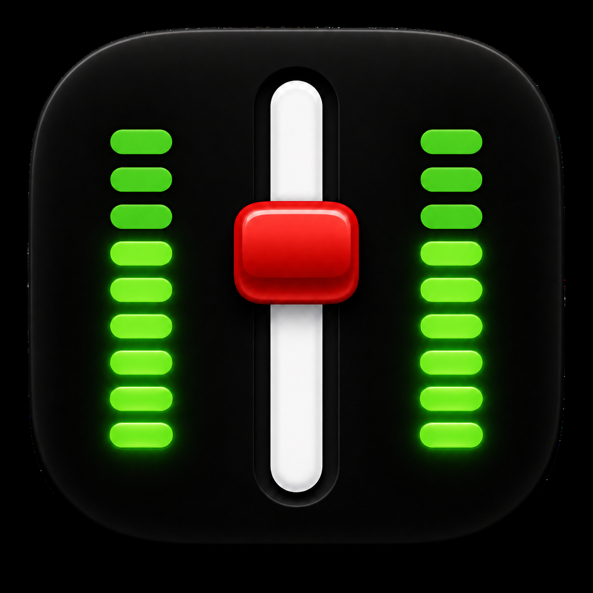
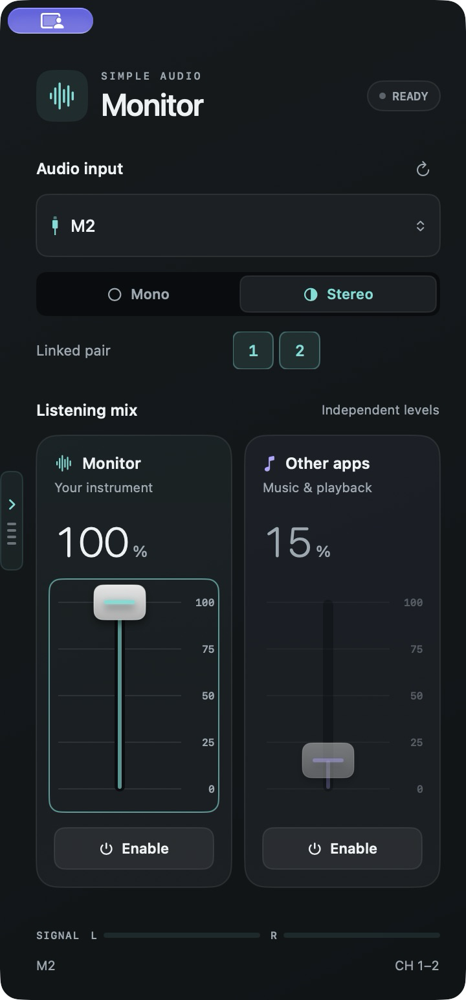

<p align="center">
  
</p>

# Simple Audio Monitor

Hear your instrument and play along with your favourite music—without opening a DAW. Simple Audio Monitor is a compact macOS app that routes an audio interface's input to your output and gives you independent volume controls for your instrument and other applications.

## Interface

<p align="center">
  
</p>

The current interface, shown in standby with an M2 audio interface selected. **Monitor** controls your instrument; **Other apps** controls music and playback on your current default output. Each panel has its own **Enable** button.

## Get started

1. Connect your instrument or pedalboard to your audio interface and choose the Mac's output device in Sound settings.
2. Select the interface under **Audio input**. Use the refresh button if you have just connected it.
3. Choose **Mono** for one input or **Stereo** for an adjacent pair. To change the starting channel, switch to Mono, select the channel, then enable Stereo if needed.
4. Press **Enable** in the **Monitor** panel and adjust its fader to hear your instrument.
5. Open a player, browser, or backing-track app. Press **Enable** under **Other apps** to adjust its playback level independently.

Allow microphone access for instrument monitoring and system audio access when enabling other-apps control for the first time. Start with comfortable output levels and use wired headphones for low-latency listening.

## Features

- **Two independent faders:** turquoise for your instrument, violet for other apps, with 0–100% scales and separate enable buttons.
- **Mono or stereo monitoring:** select a single input or link adjacent channels.
- **Live feedback:** a LIVE/READY indicator and independent L/R signal meters.
- **Keyboard control:** focus a fader and use the arrow keys for 1% adjustments.
- **Saved preferences:** restore the input device, channel, input mode, and both fader levels at launch. Audio routes start disabled.
- **Compact mode:** collapse the 360-point-wide panel to a 28-point handle with live status and miniature meters while audio keeps playing.
- **Desktop placement:** open at the bottom-right corner of the main display and move the panel using its native title bar.
- **Sleep handling:** stop both audio routes when the Mac enters sleep; enable them again when ready.

## Requirements

- macOS 14.0 or later for instrument monitoring.
- macOS 14.2 or later for **Other apps** volume control.
- An audio input device and microphone permission for monitoring.
- System audio recording permission for other-apps control.
- A compatible Swift 6 toolchain and macOS SDK to build from source.

## Build and run

Create a double-clickable app bundle:

```sh
chmod +x make-app.sh
./make-app.sh
open ".build/SimpleAudioMonitor.app"
```

The build script accepts additional `swift build` arguments, including `--sdk` when a specific installed SDK is needed.

You can also use `swift run` during development. The app bundle is recommended for normal use because it includes the permission descriptions and Dock icon.

## Audio behaviour and permissions

The instrument follows a short `input → mixer → output` path with no recording or effects. Its fader adjusts only the monitored signal. The L/R meters show the input level scaled by that fader; they do not measure hardware volume or later system processing. Actual latency depends on your interface, driver, buffer configuration, and output device.

Other-apps control uses a private Core Audio process tap and aggregate device to play captured audio at the chosen level. It excludes Simple Audio Monitor, so the instrument remains independently adjustable. Disabling **Other apps** restores normal playback. The app does not change the selected system output or hardware volume.

Only applications playing through the current default output's first stream are controlled. Applications explicitly routed to another output remain independent. Hardware and system volume still affect the final mix.

Other-apps control stops when the output device or its sample rate changes. Enable it again to use the new output. Both routes also stop on app exit, and neither starts automatically at launch.

If access is denied, check **System Settings → Privacy & Security → Microphone** for instrument monitoring, or **Screen & System Audio Recording** for other-apps control, then try enabling the corresponding panel again. Permission labels may vary with the macOS version.
